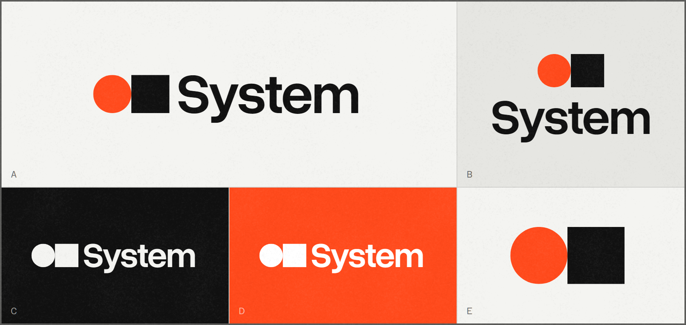
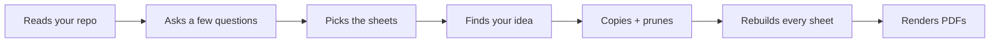

<p align="center"><a href="https://siliconlemon-system.vercel.app"></a></p>

# System

An interactive design manual template, made to get a brand, site or app off the ground before anyone writes real code.
Ideal for quick prototyping and doing client revisions over a web link.

Logo, color, type, grid, icons, buttons, screens, motion, voice, all the way to damn business cards. All on one canvas.

**Live @** [siliconlemon-system.vercel.app](https://siliconlemon-system.vercel.app)

## Start familiar, then make it yours

I'm at least somewhat faithfully mimicking Swiss-minimal here: big tight type, hairlines, lots of white space, one loud color accent.

Yes, it's one of the most copied looks out there. That's actually the point. This should allow you to start somewhere familiar, then make it your own kind of weird.

Try not to swap an accent color and two fonts and call it a day. That'd kinda miss what I'm putting down here.

A few ways in:

- **Borrow from what you're building.** Use terminology, fonts, color schemes and layouts that feel like your idea.
- **Own one shape.** There should be a clear design language that ties it all together. My example is the orange dot in `System.`
- **Set rules and stick to them.** One color per page, no straight corners, everything on 4px, whatever feels like a good bet at the start.
- **Cut hard.** There are 19 sheets because it covers everything. That's absolute overkill for most projects. You might really need about 5 to 10, and don't get me started on locales or theming.

_Quick check: hide the name on the cover. Could it be mistaken for someone else's? If so, iterate. If not, keep going._

## What's in the box

| Sheet | Decides |
| --- | --- |
| Cover, Contents | The name, and what's inside |
| Landing | What the homepage says and does |
| Logo | Construction, clear space, lockups, don'ts |
| Color | Palette, proportions, readable pairs |
| Display, Text, Mono | Faces for headings, reading, and labels and numbers |
| Grid | Columns, spacing, breakpoints |
| Icons, Imagery | The icon set, how pictures are treated |
| Components | Buttons, fields, cards, tabs |
| Apps | Welcome, empty, loading, error |
| Motion | Easing curves you can click to play |
| Voice | How it talks, with before-and-after sentences |
| Marketing, Print | Social, banners, business card, letterhead |
| Downloads, Utility | Brand files, the 404, the favicon |

Also included:

- **Fallbacks:** No logo, icons or photos yet? Flip a switch and the sheets swap in a wordmark, glyphs or drafting frames. No empty boxes.
- **Light, dark** and **EN / CS**.
- **PDF button:** Downloads exactly what you're looking at, with the same switches and language.
    - The PDF matches your current configuration, so make sure you haven't hidden anything you want in that document.
- **Works on phones:** Figured that out for you. Just copy the business logic and you should be fine to present over a web link on any platform.
- **Plain HTML, CSS, JS:** No build, no deps. Should read like a Figma export and drop into any site without extra config.

## Claude Code integration

Ships with a `design-deck` skill that turns the template into *your* project's manual:



_You can feed it a bunch of screenshots or a PDF of a design book you like, and let it go ham.
I'd strongly advise going over the result on your own afterwards, since automating with bots doesn't really breed originality, now does it?_

**Option 1: plugin** (set up once, works in every project)

```
/plugin marketplace add siliconlemon/system
/plugin install system@system
```

Then, in your project:

```
Start the design for this project. It's a <what it is>.
We have <a logo / nothing yet>, and it should feel <two or three words>.
```

The manual lands in `design/` in your repo, or wherever you tell it to, in case your stack already uses that name (looking at you, Kotlin).

**Option 2: your own copy**

Hit **Use this template** on GitHub. You get a fresh repo with none of this one's history or settings.

Open Claude Code in it and point it at your project, or just start messing with it in place.

Locations:

- Colors and fonts: top of `site/css/system.css`
- Localized resources: `site/strings/en.js`

The rest should be found in the places a web dev would expect.

## Under the hood

```
site/
  index.html        every sheet
  css/system.css    tokens + every component
  js/canvas.js      the zoomable canvas
  js/system.js      switches, theme, language, the bars
  strings/*.js      every word, per language
scripts/
  prune.py          --keep logo,color,type   cut to the sheets you name
  strings.py        check no word is missing anywhere
  pdf.py            render the PDFs (needs Chrome or Edge)
skills/design-deck/ the skill + notes on every sheet
```

## Fonts

- Overused Grotesk for headings and big text.
- Hanken Grotesk for body text.
- Azeret Mono and Courier Prime for mono, one technical and one decorative.

All free under the SIL Open Font License, but I do encourage you to find your own on Google Fonts or similar.
